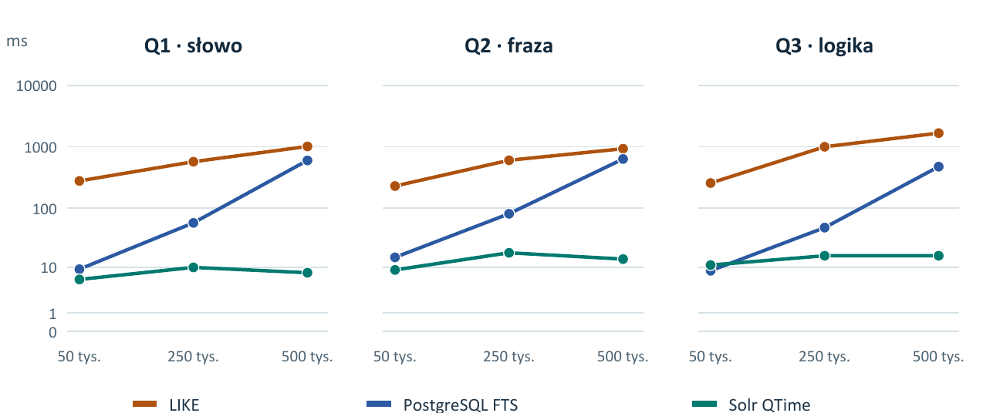

# Laboratorium nr 3

##  Wyszukiwanie pełnotekstowe: SQL kontra Solr 

**Poziom zadania** · 5.0

**Autorzy** · Michał Ciesielczyk i Piotr Gąska


## Wstęp

Celem laboratorium było porównanie trzech sposobów wyszukiwania tekstu: operatora `LIKE`, wyszukiwania pełnotekstowego w PostgreSQL oraz wyszukiwania w Apache Solr. Wybraliśmy poziom **5.0**. Na tym samym zbiorze sprawdziliśmy liczbę i kolejność trafień, dostępne funkcje oraz czasy zapytań dla 50 000, 250 000 i 500 000 rekordów.

## Zbiór danych

Skrypt [`generate.py`](../generate.py) tworzy **500 000 unikalnych rekordów** i zapisuje je w pliku CSV. Każdy rekord to fikcyjna notatka terenowa po angielsku. Generator losuje warianty pełnych zdań oraz uzupełnia je nazwami miejsc, warunkami pogodowymi i wynikami pomiarów. Kontrola opisów wykazała **0 identycznych opisów**.

| Pole | Zawartość |
| --- | --- |
| `id` | Unikalny identyfikator od 1 do 500 000 |
| `title` | Tytuł notatki |
| `body` | Opis w języku naturalnym, średnio **608 znaków** na rekord |
| `category` | Kategoria stanowiska, 6 możliwych wartości |
| `region` | Region, 5 możliwych wartości |
| `year` | Rok obserwacji od 1995 do 2024 |

CSV z 500 000 notatek zajmuje 335 685 609 bajtów, czyli 320,1 MiB.


### Przykładowe rekordy

**ID 1 · Stream crossing survey at Willow Bank**  
Kategoria `water`, region `central`, rok `1999`.

> Staff returned to the stream crossing at Willow Bank after an overnight storm to review the previous season’s notes. Within a survey area of 89 square metres, they marked 37 places for a closer look during the next visit.

**ID 2 · Rocky slope survey at Larch Gap**  
Kategoria `upland`, region `west`, rok `2016`.

> Volunteers met at Larch Gap to check the rocky slope following a cold morning. A second group recorded 63 changes along the edge of a 2073-square-metre plot and sketched the points on a paper map.


## Import i indeksowanie

### 1. PostgreSQL 17.12

Skrypt `load.py` wczytuje 500 000 rekordów z CSV poleceniem `COPY`. Pole `id` jest kluczem głównym. PostgreSQL automatycznie wylicza kolumnę `search_vector` z tytułu i opisu, korzystając z angielskiej konfiguracji `english`. Po imporcie skrypt tworzy na tej kolumnie indeks GIN.

```sql
CREATE TABLE field_notes_500000 (
    id integer PRIMARY KEY,
    title text NOT NULL,
    body text NOT NULL,
    category text NOT NULL,
    region text NOT NULL,
    year smallint NOT NULL,
    search_vector tsvector GENERATED ALWAYS AS (
        setweight(to_tsvector('english', title), 'A')
        || to_tsvector('simple', 'documentsectionboundary')
        || setweight(to_tsvector('english', body), 'D')
    ) STORED
);

CREATE INDEX field_notes_500000_gin
ON field_notes_500000 USING GIN (search_vector);
```

Tytuł otrzymuje wyższą wagę `A`, a opis wagę `D`. Znacznik `documentsectionboundary` oddziela oba pola, żeby dwuwyrazowa fraza nie pasowała na granicy tytułu i opisu.

### 2. Apache Solr 10.1.0

Solra uruchamiamy z rozpakowanej paczki. Loader odczytuje ten sam CSV i wysyła dokumenty do `/update` partiami po **2000 rekordów**. Po wysłaniu ostatniej partii wykonuje jeden `commit`. Kolekcja `lab3_500000` korzysta z poniższego schematu, a automatyczne dodawanie pól jest wyłączone przez `update.autoCreateFields=false`.

```xml
<schema name="field-notes" version="1.7">
  <fieldType name="string" class="solr.StrField"/>
  <fieldType name="int" class="solr.IntPointField"/>
  <fieldType name="long" class="solr.LongPointField"/>

  <fieldType name="english_text" class="solr.TextField"
             positionIncrementGap="100">
    <analyzer>
      <tokenizer name="standard"/>
      <filter name="lowercase"/>
      <filter name="stop" words="stopwords.txt" ignoreCase="false"/>
      <filter name="snowballPorter" language="English"/>
    </analyzer>
  </fieldType>

  <field name="id" type="string" indexed="true" stored="true"
         docValues="true" multiValued="false" required="true"/>
  <field name="title" type="english_text" indexed="true" stored="true"
         docValues="false" multiValued="false" required="true"/>
  <field name="body" type="english_text" indexed="true" stored="true"
         docValues="false" multiValued="false" required="true"
         storeOffsetsWithPositions="true"/>
  <field name="category" type="string" indexed="true" stored="true"
         docValues="true" multiValued="false" required="true"/>
  <field name="region" type="string" indexed="true" stored="true"
         docValues="true" multiValued="false" required="true"/>
  <field name="year" type="int" indexed="true" stored="true"
         docValues="true" multiValued="false" required="true"/>
  <field name="_version_" type="long" indexed="false" stored="false"
         docValues="true" multiValued="false"/>

  <uniqueKey>id</uniqueKey>
</schema>
```

W polach `title` i `body` Solr dzieli tekst na tokeny, zamienia litery na małe, pomija słowa z `stopwords.txt` i stosuje angielski stemming Snowball. Dzięki temu zapytanie `restore` obejmuje również odmiany takie jak `restored` i `restoring`.

## Zadanie na 3.0

### 1. PostgreSQL

Wykonaliśmy trzy zapytania pełnotekstowe:

1. **Q1 – pojedyncze słowo.** Szukaliśmy `restore` i jego odmian, np. `restored` i `restoring`.
2. **Q2 – fraza.** Szukaliśmy `"solar panel"`. Słowa musiały wystąpić obok siebie i w podanej kolejności.
3. **Q3 – logika z negacją.** Szukaliśmy notatek zawierających `habitat` oraz co najmniej jedno ze słów `wetland` lub `marsh`. Wykluczyliśmy notatki zawierające `invasive`.

Dla Q1 wykonaliśmy też `LIKE '%restore%'` na tytule i opisie po zamianie liter na małe. We wszystkich zapytaniach zastosowaliśmy filtr lat **2000–2024**. Czas w PostgreSQL odczytaliśmy z `Execution Time` podanego przez `EXPLAIN ANALYZE`.


#### Zapytania PostgreSQL

```sql
-- Q1 · Słowo „restore” i jego odmiany
SELECT count(*)
FROM field_notes_500000
WHERE year BETWEEN 2000 AND 2024
  AND search_vector @@ to_tsquery('english', 'restore');

-- Q2 · Fraza „solar panel”
SELECT count(*)
FROM field_notes_500000
WHERE year BETWEEN 2000 AND 2024
  AND search_vector @@ phraseto_tsquery('english', 'solar panel');

-- Q3 · „habitat” i („wetland” lub „marsh”), z wykluczeniem „invasive”
SELECT count(*)
FROM field_notes_500000
WHERE year BETWEEN 2000 AND 2024
  AND search_vector @@ to_tsquery('english', 'habitat & (wetland | marsh) & !invasive');

-- Q1 · Porównanie przez LIKE
SELECT count(*)
FROM field_notes_500000
WHERE year BETWEEN 2000 AND 2024
  AND (
    lower(title) LIKE '%restore%'
    OR lower(body) LIKE '%restore%'
  );
```

Do pomiaru czasu poprzedziliśmy każde zapytanie poleceniem `EXPLAIN (ANALYZE, BUFFERS, TIMING OFF, FORMAT JSON)` i odczytaliśmy `Execution Time`.

### 2. Apache Solr

Kolekcja `lab3_500000` ma własny schemat, a automatyczne dodawanie pól jest wyłączone ustawieniem `update.autoCreateFields=false`.

W schemacie `id` jest kluczem unikalnym, `title` i `body` mają typ `english_text`, `category` i `region` mają typ `string`, a `year` jest liczbą całkowitą. Loader wysłał cały zbiór do `/update` partiami po **2 000 dokumentów**. Na końcu wykonał **jeden `commit`**.

Powtórzyliśmy Q1, Q2 i Q3 w Solrze. Parametr `q` określa treść zapytania, `fq` filtruje lata, `fl` wybiera pola do zwrócenia, `sort` ustala kolejność, a `rows` określa liczbę dokumentów w odpowiedzi. Każde zapytanie otworzyliśmy też w przeglądarce jako pełny URL. 
#### Zapytania Solr

W każdym żądaniu do `/solr/lab3_500000/select` zmienialiśmy parametr `q`.

| Zapytanie | Wartość parametru `q` |
| --- | --- |
| Q1 | `restore` |
| Q2 | `"solar panel"` |
| Q3 | `habitat AND (wetland OR marsh) AND NOT invasive` |

Pozostałe parametry były wspólne.

| Parametr | Wartość |
| --- | --- |
| `defType` | `edismax` |
| `qf` | `title^3 body` |
| `fq` | `year:[2000 TO 2024]` |
| `fl` | `id,title,category,region,year,score` |
| `sort` | `score desc,id asc` |
| `rows` | `0` podczas pomiaru liczby trafień, `10` przy sprawdzeniu w przeglądarce |
| `wt` | `json` |

Przy `rows=0` Solr zwraca łączną liczbę trafień w `numFound`. Do sprawdzenia w przeglądarce użyliśmy adresów pokazujących po 10 dokumentów.


### 3. Wyniki

Czasy pochodzą z **drugiego uruchomienia** na zbiorze 500 000 rekordów. `numFound` to łączna liczba trafień w Solrze, a `QTime` to czas podany przez serwer Solra.

| Zapytanie | Liczba wyników w PostgreSQL | `numFound` w Solrze | Czas PostgreSQL [ms] | `QTime` Solra [ms] |
| --- | ---: | ---: | ---: | ---: |
| Q1 `restore` | 62 565 | 62 565 | 601,86 | 9 |
| Q2 `"solar panel"` | 27 169 | 27 169 | 622,63 | 18 |
| Q3 `habitat AND (wetland OR marsh) AND NOT invasive` | 44 514 | 44 514 | 543,37 | 19 |
| Q1 `LIKE '%restore%'` | 37 674 | — | 1 043,60 | — |

W Q1 `LIKE` znalazł mniej notatek, ponieważ szukał ciągu znaków `restore`, który występuje w `restored`, ale pomija formy `restoring` i `restoration`. PostgreSQL i Solr stosują stemming, który sprowadza te odmiany do wspólnego rdzenia (W obu silnikach zastosowaliśmy angielski stemming Snowball), i w badanych zapytaniach zwróciły tyle samo trafień. W innych zapytaniach różnice mogą wynikać z tokenizacji, czyli sposobu dzielenia tekstu na słowa, oraz z list pomijanych słów. [Zapis pomiarów](../results/counts.json)


## Zadanie na 4.0

Na poziomie 4.0 wykorzystaliśmy ten sam zbiór **500 000 notatek** i zapytania Q1–Q3 z poziomu 3.0. Dodaliśmy ranking, grupowanie wyników, facety, podświetlanie oraz test odporności na literówki.

### 1. PostgreSQL

#### Ranking top 10

Dla każdego zapytania PostgreSQL obliczał wynik trafności funkcją `ts_rank_cd`. Uwzględnia ona m.in. pozycje dopasowanych słów i wagę pola. W `search_vector` tytuł ma wagę `A`, a opis wagę `D`. Wyniki sortowaliśmy malejąco według wyniku punktowego, a przy remisie rosnąco według `id`.

Przykład dla Q1:

```sql
SELECT id, title, category, region, year,
       ts_rank_cd(search_vector, to_tsquery('english', 'restore')) AS score
FROM field_notes_500000
WHERE year BETWEEN 2000 AND 2024
  AND search_vector @@ to_tsquery('english', 'restore')
ORDER BY score DESC, id ASC
LIMIT 10;
```

W Q2 użyliśmy `phraseto_tsquery('english', 'solar panel')`, a w Q3 `to_tsquery('english', 'habitat & (wetland | marsh) & !invasive')`. W obu przypadkach to samo wyrażenie służyło do filtrowania i obliczenia wyniku trafności. [Zapytania i wyniki top 10](../results/rankings.json)

#### Grupowanie wyników

Wyniki Q3 pogrupowaliśmy według kategorii. Przykładowo `water` miało **18 183 trafienia**, a `coast` **17 858**.

```sql
SELECT category, count(*) AS hits
FROM field_notes_500000
WHERE year BETWEEN 2000 AND 2024
  AND search_vector @@ to_tsquery('english', 'habitat & (wetland | marsh) & !invasive')
GROUP BY category
ORDER BY category;
```

### 2. Apache Solr

#### Schemat i flagi pól

| Flaga | Jak jej użyliśmy |
| --- | --- |
| `indexed` | Pola danych są indeksowane, żeby można było w nich wyszukiwać albo po nich filtrować. |
| `stored` | Pola danych są przechowywane, żeby można było zwrócić ich wartości w odpowiedzi. Przechowanie `body` umożliwia też pokazanie fragmentu opisu. |
| `docValues` | Włączone dla `id`, `category`, `region` i `year`, wykorzystywanych m.in. do sortowania i facetów. Wyłączone dla analizowanego tekstu `title` i `body`. |
| `multiValued` | Wyłączone, ponieważ każda notatka ma po jednej wartości w każdym polu. |

[Pełny schemat Solra](../solr/managed-schema.xml)

#### Ranking, facety i podświetlanie

Dla Q1–Q3 użyliśmy `defType=edismax`, `qf=title^3 body`, `sort=score desc,id asc` i `rows=10`. Ustawienie `qf` daje dopasowaniu w tytule większą wagę niż dopasowaniu w opisie. Treść `q` i filtr lat były takie same jak na poziomie 3.0.

Dla Q3 włączyliśmy `facet=true` oraz dwa parametry `facet.field`, osobno dla `category` i `region`. Przykładowo facet `category` pokazał **18 183** notatki z kategorii `water`, a facet `region` **8 937** z regionu `central`.

Do podświetlania włączyliśmy `hl=true`, `hl.fl=body` i `hl.method=unified`. Przykładowy fragment zwrócony dla dokumentu `271306` w Q3:

```html
Several birds use the <em>marsh</em> as feeding <em>habitat</em> during their spring migration.
```

[Zapytania Solra](../zapytania.html) · [Zapis facetów](../results/facets.json)

### 3. Porównanie rankingów

| Zapytanie | Wspólne dokumenty w top 10 | Obserwacja |
| --- | ---: | --- |
| Q1 `restore` | 2/10 | Wspólne ID to `000244` i `000259`. |
| Q2 `"solar panel"` | 10/10 | Oba silniki zwróciły te same 10 dokumentów w tej samej kolejności. |
| Q3 z negacją `invasive` | 0/10 | Każdy silnik umieścił w pierwszej dziesiątce inne dokumenty. |


#### Skąd różnice w rankingu?

Wyszukiwanie odbywa się w dwóch krokach. Najpierw silnik ustala, które dokumenty spełniają warunki zapytania. Następnie przyznaje im punkty i sortuje je według trafności. W Q3 oba silniki znalazły po **44 514 notatek**, a ich pierwsze dziesiątki miały **0 wspólnych dokumentów**.

W PostgreSQL użyliśmy funkcji `ts_rank_cd`, która bierze pod uwagę m.in. odległość między pasującymi słowami. Przykładowo zapis `wetland habitat` w opisie może dostać więcej punktów niż opis, w którym te słowa są daleko od siebie. Dopasowania w tytule mają u nas większą wagę niż dopasowania w opisie.

W Solrze zastosowaliśmy BM25. Przy punktowaniu liczy się m.in. to, jak często słowo występuje w danym polu, jak rzadkie jest w całym zbiorze i jak długie jest pole. Przykładowo pojedyncze wystąpienie `habitat` w krótkim opisie może dostać więcej punktów niż pojedyncze wystąpienie w długim opisie. Dodatkowo w eDisMax ustawiliśmy `qf=title^3 body`, które zwiększa wpływ dopasowania w tytule na punktację.

W Q3 bliskość `wetland` i `habitat` może podnieść pozycję jednej notatki w PostgreSQL, a dopasowanie w krótkim tytule może podnieść pozycję innej w Solrze. Obie notatki mogą spełniać warunki Q3. O ich miejscu na liście decydują zasady punktowania danego silnika.

 [Pełne rankingi z ID i punktacją](../results/rankings.json)

### 4. Pomiary

| System | Etap | Czas [s] |
| --- | --- | ---: |
| PostgreSQL | Import `COPY` wraz z obliczaniem `search_vector` | 188,93 |
| PostgreSQL | Budowa indeksu GIN | 19,52 |
| Solr | Wysyłanie i indeksowanie partii dokumentów | 122,89 |
| Solr | Końcowy `commit` | 1,55 |

W Solrze dokumenty są analizowane i indeksowane podczas wysyłania partii. Czas końcowego `commit` obejmuje zatwierdzenie i udostępnienie indeksu do wyszukiwania.

Poniżej podano **mediany z pięciu prób po rozgrzewce** na 500 000 rekordów. Pomiary zapytań dotyczą liczenia trafień. Dla wszystkich trzech przypadków przygotowaliśmy też wariant oparty na `LIKE`, który sprawdza dosłowne ciągi znaków.

| Zapytanie | PostgreSQL `LIKE` [ms] | PostgreSQL FTS [ms] | Solr `QTime` [ms] | Solr pełne HTTP [ms] |
| --- | ---: | ---: | ---: | ---: |
| Q1 `restore` | 1017,38 | 601,86 | 8 | 10,41 |
| Q2 `"solar panel"` | 933,74 | 635,55 | 14 | 16,26 |
| Q3 z negacją `invasive` | 1674,20 | 476,60 | 16 | 18,23 |

[Zapis prób pomiarowych](../results/counts.json) · [Import PostgreSQL](../results/load_pg_500000.json) · [Import Solra](../results/load_solr_500000.json)

### 5. Rozszerzenie – odporność na literówki

Sprawdziliśmy literówkę `soalr` zamiast `solar`. W Solrze zapis `soalr~1` dopuszcza jedną zmianę, w tym zamianę miejscami dwóch sąsiednich liter.

| Zapytanie | System i metoda | Trafienia |
| --- | --- | ---: |
| `solar` | Solr, zwykłe zapytanie | 52 801 |
| `soalr` | Solr, zwykłe zapytanie | 0 |
| `soalr~1` | Solr, zapytanie fuzzy | 52 801 |
| `%soalr%` | PostgreSQL, `LIKE` | 0 |

Zapytanie fuzzy dało w tym teście tyle samo trafień co zapytanie z poprawną pisownią. [Wyniki testu literówki](../results/fuzzy.json)


## Zadanie na 5.0

Na poziomie 5.0 sprawdziliśmy, jak rosną czasy zapytań wraz z wielkością zbioru. Porównaliśmy też facety Solra z agregacjami PostgreSQL. Jako dwa dodatkowe rozszerzenia wybraliśmy **głębokie stronicowanie** oraz **synchronizację zmian z PostgreSQL do Solra**.

### 1. Skalowanie wyszukiwania

Przygotowaliśmy trzy rozmiary zbioru: **50 000, 250 000 i 500 000 rekordów**, czyli 10%, 50% i 100% danych. Dla każdego rozmiaru utworzyliśmy osobną tabelę i indeks GIN w PostgreSQL oraz osobną kolekcję w Solrze. Oba silniki dostały te same rekordy, a we wszystkich zapytaniach zastosowaliśmy ten sam filtr lat 2000–2024.

Dla Q1, Q2 i Q3 porównaliśmy `LIKE`, PostgreSQL FTS i Solra. Zapytania liczyły trafienia. W PostgreSQL mierzyliśmy `SELECT count(*)`, a w Solrze ustawiliśmy `rows=0` i odczytaliśmy `numFound` oraz `QTime`. Każdą serię rozpoczęliśmy od jednej próby rozgrzewkowej, po której obliczyliśmy medianę z pięciu pomiarów.



Oś pionowa pokazuje czas w milisekundach w skali `log10(1 + czas)`. Dzięki temu na jednym wykresie widać zarówno czasy rzędu kilku milisekund, jak i wyniki powyżej jednej sekundy.

| Liczba rekordów | Zapytanie | `LIKE` [ms] | PostgreSQL FTS [ms] | Solr `QTime` [ms] |
| ---: | --- | ---: | ---: | ---: |
| 50 000 | Q1 | 278,93 | 9,28 | 6 |
| 50 000 | Q2 | 230,11 | 15,01 | 9 |
| 50 000 | Q3 | 257,64 | 8,71 | 11 |
| 250 000 | Q1 | 573,30 | 57,22 | 10 |
| 250 000 | Q2 | 605,09 | 80,90 | 18 |
| 250 000 | Q3 | 1004,74 | 47,75 | 16 |
| 500 000 | Q1 | 1017,38 | 601,86 | 8 |
| 500 000 | Q2 | 933,74 | 635,55 | 14 |
| 500 000 | Q3 | 1674,20 | 476,60 | 16 |

**Wniosek.** `LIKE` przekraczał próg 100 ms już przy 50 000 rekordów we wszystkich trzech zapytaniach. PostgreSQL FTS mieścił się w nim do 250 000 rekordów, a przy 500 000 przekroczył go w każdym zapytaniu. Solr mieścił się w progu dla wszystkich badanych rozmiarów. Przy 50 000 rekordów dla Q3 PostgreSQL FTS był nawet trochę szybszy od Solra. Największą różnicę widać dopiero na pełnym zbiorze. [Surowe pomiary](../results/counts.json)

### 2. Facety w Solrze a agregacje w PostgreSQL

Do porównania użyliśmy **Q3**, które na pełnym zbiorze dało **44 514 trafień**. Jedno żądanie do Solra policzyło, ile z tych trafień przypada na każdą kategorię, region i pięcioletni przedział lat.

Najważniejsze parametry tego żądania:

```text
q=habitat AND (wetland OR marsh) AND NOT invasive
fq=year:[2000 TO 2024]
rows=0
facet=true
facet.field=category
facet.field=region
facet.range=year
facet.range.start=2000
facet.range.end=2025
facet.range.gap=5
facet.range.hardend=true
```

Pierwszy przedział obejmuje lata **2000–2004**, drugi **2005–2009** i tak dalej. Rok 2025 jest górną granicą ostatniego przedziału.

W PostgreSQL wykonaliśmy trzy `GROUP BY` na wynikach tego samego Q3. Dla kategorii i regionu grupowaliśmy bezpośrednio po kolumnie. Dla roku wyliczaliśmy najpierw początek pięcioletniego przedziału:

```sql
SELECT 2000 + 5 * ((year - 2000) / 5) AS bucket, count(*) AS hits
FROM field_notes_500000
WHERE year BETWEEN 2000 AND 2024
  AND search_vector @@ to_tsquery('english', 'habitat & (wetland | marsh) & !invasive')
GROUP BY bucket
ORDER BY bucket;
```

Przykładowo dla roku `2007` wyrażenie zwraca `2005`, więc notatka trafia do przedziału **2005–2009**. Sprawdziliśmy też `GROUPING SETS`, które pozwala policzyć wszystkie trzy podziały w jednym zapytaniu SQL.

**Wszystkie 16 grup miało identyczne liczności w obu silnikach.**

| Podział | Wartość | PostgreSQL | Solr |
| --- | --- | ---: | ---: |
| Kategoria | `coast` | 17 858 | 17 858 |
| Kategoria | `grassland` | 2 178 | 2 178 |
| Kategoria | `upland` | 2 128 | 2 128 |
| Kategoria | `urban` | 2 032 | 2 032 |
| Kategoria | `water` | 18 183 | 18 183 |
| Kategoria | `woodland` | 2 135 | 2 135 |
| Region | `central` | 8 937 | 8 937 |
| Region | `east` | 8 893 | 8 893 |
| Region | `north` | 8 983 | 8 983 |
| Region | `south` | 8 879 | 8 879 |
| Region | `west` | 8 822 | 8 822 |
| Rok | 2000–2004 | 8 840 | 8 840 |
| Rok | 2005–2009 | 8 831 | 8 831 |
| Rok | 2010–2014 | 8 909 | 8 909 |
| Rok | 2015–2019 | 8 951 | 8 951 |
| Rok | 2020–2024 | 8 983 | 8 983 |

| Metoda | Mediana [ms] |
| --- | ---: |
| PostgreSQL `GROUP BY category` | 520,90 |
| PostgreSQL `GROUP BY region` | 498,21 |
| PostgreSQL `GROUP BY` po przedziale lat | 501,64 |
| PostgreSQL, łączny czas trzech `GROUP BY` w jednej próbie | 1535,54 |
| PostgreSQL, jedno zapytanie `GROUPING SETS` | 521,38 |
| Solr, jedno żądanie z trzema facetami (`QTime`) | 24 |
| Solr, to samo żądanie mierzone po stronie klienta | 26,89 |

`GROUPING SETS` skróciło czas w PostgreSQL z ok. **1,54 s** do **0,52 s**. Solr zwrócił te same trzy podziały w jednym żądaniu z medianą ok. **27 ms** po stronie klienta. [Zapytania i wyniki facetów](../results/facets.json)

### 3. Rozszerzenie 1 – głębokie stronicowanie

Porównaliśmy dwa sposoby pobierania dalekich stron w Solrze. W obu przypadkach wybraliśmy wszystkie dokumenty (`q=*:*`), pobieraliśmy po **1000 wyników** i sortowaliśmy je według `year asc,id asc`. Unikalne `id` rozstrzygało kolejność dokumentów z tego samego roku.

- **`start` i `rows`** pozwalają wskazać pozycję wprost. `start=250000&rows=1000` oznacza pominięcie pierwszych 250 000 dokumentów i pobranie kolejnego tysiąca.
- **`cursorMark`** działa jak zakładka między stronami. Zaczynamy od `cursorMark=*`. Solr zwraca `nextCursorMark`, który przekazujemy w następnym żądaniu.

| Pominięte dokumenty | `start` · mediana `QTime` [ms] | `cursorMark` · mediana `QTime` [ms] | Wcześniejsze żądania potrzebne do uzyskania kursora | Łączny czas tych żądań po stronie klienta [s] |
| ---: | ---: | ---: | ---: | ---: |
| 1 000 | 41 | 27 | 1 | 0,11 |
| 50 000 | 346 | 22 | 50 | 2,14 |
| 250 000 | 1333 | 30 | 250 | 8,85 |

Dla każdej badanej strony **kolejność wszystkich 1000 ID była identyczna** w obu wariantach. Gdy kursor był już znany, pobranie strony po 250 000 dokumentów zajęło **30 ms** wobec **1333 ms** przy `start`. Dojście do tego kursora od pierwszej strony wymagało jednak 250 wcześniejszych żądań. Kursor sprawdza się przy przechodzeniu po kolei, np. podczas eksportu. `start` pozwala skoczyć na wybraną stronę od razu. [Wyniki stronicowania](../results/pagination.json)

### 4. Rozszerzenie 2 – aktualizacja i usuwanie danych

Sprawdziliśmy, czy zmiany w PostgreSQL można przenieść do Solra tak, żeby oba systemy dalej zwracały te same wyniki.

1. Sprawdziliśmy stan początkowy. Oba systemy miały **500 000 rekordów**, a wyszukiwanie `calibration` zwracało **0 trafień**.
2. W PostgreSQL dopisaliśmy zdanie zawierające `calibration` do opisów rekordów **13 i 37** oraz usunęliśmy rekord **81**.
3. Skrypt [`sync_demo.py`](../sync_demo.py) odczytał zaktualizowane rekordy z PostgreSQL, wysłał je do `/update` w Solrze, przekazał polecenie usunięcia rekordu 81 i wykonał `commit`.
4. Sprawdziliśmy liczbę rekordów, ID trafień dla `calibration` oraz wartości pól zmienionych dokumentów. Po teście przywróciliśmy pierwotne dane w obu systemach.

| Stan | Liczba rekordów w każdym systemie | ID wyników dla `calibration` w obu systemach | Czy rekord 81 jest obecny? |
| --- | ---: | --- | --- |
| Przed zmianą | 500 000 | Brak | Tak |
| Po synchronizacji | 499 999 | `13`, `37` | Nie |
| Po przywróceniu danych | 500 000 | Brak | Tak |

Test pokazał, że po przeniesieniu zmian można uzyskać te same wyniki w bazie i w Solrze. W naszym projekcie odpowiada za to osobny skrypt, który aktualizuje indeks Solra po zapisaniu zmian w PostgreSQL. [Zapis testu synchronizacji](../results/sync.json)


## Metodyka pomiarów

Pomiary wykonaliśmy na komputerze z procesorem Intel Core i5-8300H (4 rdzenie, 8 wątków), 20 GiB RAM i dyskiem SSD WDC WDS500G1B0C-00S6U0. Użyliśmy PostgreSQL 17.12 i Apache Solr 10.1.0. Solrowi przydzieliliśmy 2 GB pamięci JVM (`SOLR_HEAP=2g`).

Dla każdego rozmiaru zbioru do obu silników wgraliśmy te same rekordy i wykonaliśmy odpowiadające sobie zapytania. Pierwsze uruchomienie służyło rozgrzewce. W tabeli na 3.0 podaliśmy czas drugiego uruchomienia, a w dalszych porównaniach medianę z pięciu prób po rozgrzewce.

W PostgreSQL odczytywaliśmy `Execution Time` z `EXPLAIN (ANALYZE, BUFFERS, TIMING OFF, FORMAT JSON)`. W Solrze zapisywaliśmy `QTime` oraz pełny czas żądania zmierzony po stronie klienta. Dokładne zapytania, liczby trafień i czasy są w [pomiarach wyszukiwania](../results/measurements_counts.jsonl), [pomiarach funkcji dodatkowych](../results/measurements_features.jsonl) i [pomiarach stronicowania](../results/measurements_pagination.jsonl).


## Wnioski

`LIKE '%restore%'` znalazł **37 674 notatki**, a PostgreSQL FTS i Solr po **62 565**. Wyszukiwanie pełnotekstowe uwzględniło także odmiany takie jak `restoring` i `restoration`.

Przy przyjętym progu **100 ms** PostgreSQL z indeksem GIN wystarczał dla wszystkich trzech zapytań do **250 000 rekordów**. Przy **500 000 rekordów** PostgreSQL liczył trafienia w **477–636 ms**, a Solr w **8–16 ms** po stronie serwera. Solr zwrócił też trzy facety w około **27 ms** po stronie klienta, podczas gdy PostgreSQL potrzebował około **521 ms** na `GROUPING SETS`.

W naszym teście PostgreSQL FTS sprawdził się na mniejszych zbiorach. Solr dawał największą korzyść na pełnym zbiorze i przy funkcjach takich jak facety, podświetlanie oraz wyszukiwanie z literówką. Wiąże się to z utrzymaniem osobnego indeksu i synchronizacją zmian z bazą.